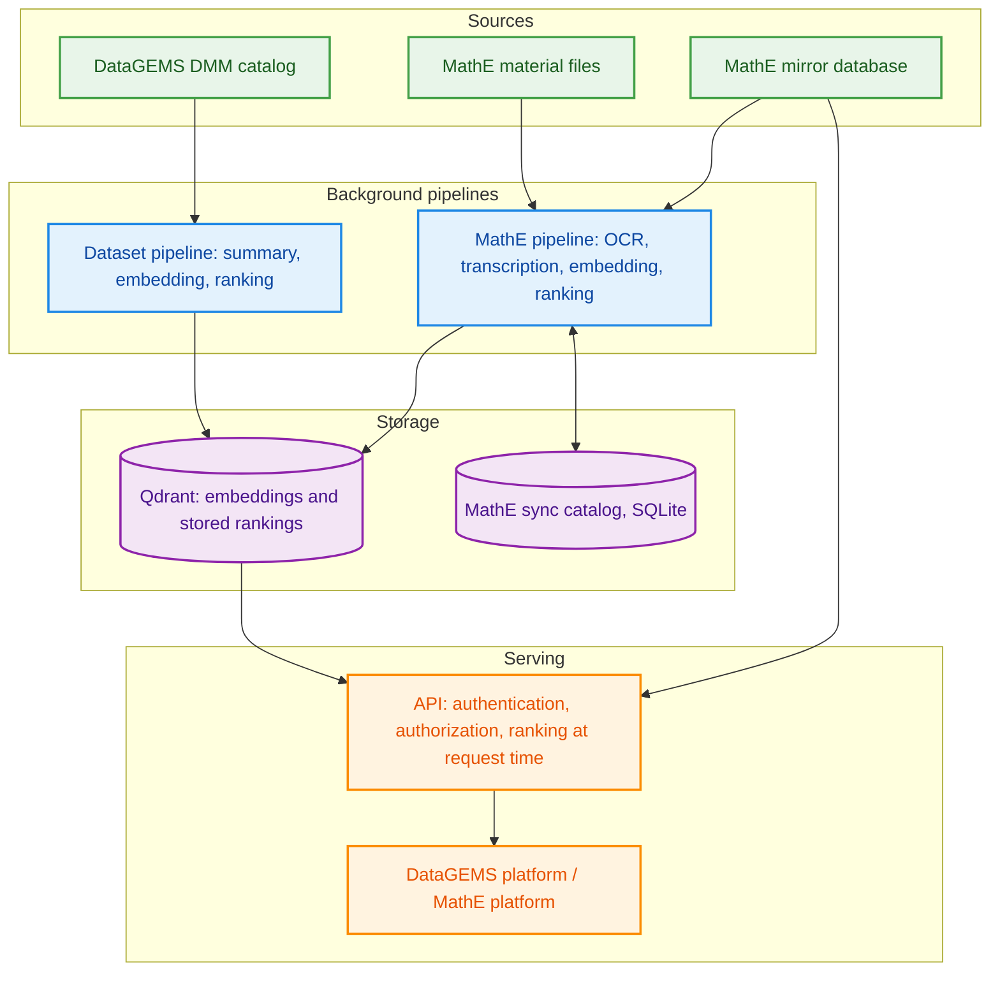

# Architecture Overview

The Dataset Recommendation Service hosts two recommenders behind one API:

- the **DataGEMS dataset recommender**, which suggests datasets related to a
  dataset a user is looking at;
- the **MathE material recommender**, which suggests teaching documents and
  videos for a mathematics question in the Higher Education use case.

Both follow the same principle: the expensive work (text extraction, language
model calls, embedding) happens ahead of time in background pipelines, and a
request is answered from stored vectors and stored rankings.

## System at a Glance

## Components

| Component | Role | Technology |
|---|---|---|
| API layer | Authenticates the caller, checks roles, applies per-user authorization, and returns ranked IDs | FastAPI, OIDC bearer tokens |
| Vector store | Holds one embedding per dataset or material, its provenance, and its stored ranking of related items | Qdrant |
| Dataset pipeline | Builds the dataset index from the DataGEMS catalog | DMM API, Claude on Amazon Bedrock, `allenai/specter2_base` |
| MathE pipeline | Turns material files and videos into text, embeds them, and builds the MathE index | LibreOffice, SCAYLE or Bedrock OCR, `faster-whisper`, `BAAI/bge-m3` |
| MathE sync catalog | Checkpoint of every discovered material: status, extracted text, and the model that produced it | SQLite file under `MATHE_PATH` |
| MathE mirror database | Read-only source of question and material metadata: topic, subtopic, keywords | PostgreSQL |
| Request log | One record per dataset recommendation request, kept for six months | SQLite file at `REQUEST_LOG_DB_PATH` |

The service keeps no user profiles and does no behavioural tracking. A
recommendation depends only on the content of the datasets or materials and on
what the caller is allowed to see.

## Recommendation Methods

### Dataset Recommender

1. **Representation.** For each dataset, a language model writes a short
   catalog summary from the dataset's title, headline, description, keywords
   and field of science. The text that is embedded is the title followed by
   that summary. This gives every dataset a description of comparable length
   and style, however sparse or uneven its original metadata is.
2. **Embedding.** The text is embedded with `allenai/specter2_base`, a model
   trained on scientific documents, using mean pooling.
3. **Ranking.** Datasets are compared by cosine similarity. Each dataset stores
   its complete ranking of all other datasets, with scores.
4. **Serving.** At request time the stored ranking is filtered to the datasets
   the calling user is authorized to see, and the top `n` are returned.

The complete ranking is stored on purpose. Because results are filtered per
user, a short stored list could be emptied by the filter even though related
datasets the user may see exist further down the ranking.

The embedding step and the ranking step are separate, so a reranking stage can
be added between them later. The current pipeline does not use one.

Details: [Workflows](workflows.md).

### MathE Material Recommender

1. **Curricular filter.** Only materials assigned to the same topic and
   subtopic as the question are candidates. This is a hard rule, not a score.
2. **Two signals per candidate.**
    - `keyword_jaccard`: overlap between the question's keywords and the
      material's keywords, both assigned by MathE.
    - question-to-material similarity: cosine similarity between the embedded
      question text and the embedded material text (OCR text for documents,
      transcript for videos), both embedded with `BAAI/bge-m3`.
3. **Score.** `final_score = w * keyword_jaccard + (1 - w) * similarity`, with
   `w = 0.6` by default.
4. **No arbitrary results.** A material with a final score of zero has no
   signal and is left out, so a list can be shorter than requested or empty.

Documents and videos are indexed and served separately and are never mixed in
one list.

Details: [MathE Material Recommender](mathe_material_recommender.md),
[MathE Document and Video Separation](mathe_content_separation.md),
[MathE Workflows](mathe_workflows.md).

## What Qdrant Stores

| Collection | Application namespace | One point per | Vector |
|---|---|---|---|
| `dataset_embeddings` | `ds2ds` | DataGEMS dataset | `allenai/specter2_base`, 768 dimensions |
| `mathe_embeddings` | `mathe_documents` | MathE document (PDF, DOCX, PPTX) | `BAAI/bge-m3`, 1024 dimensions |
| `mathe_embeddings` | `mathe_videos` | MathE video lesson or review | `BAAI/bge-m3`, 1024 dimensions |

Each point carries, next to its vector:

- the entity ID and its application namespace;
- the exact text that was embedded;
- provenance: embedding model, enrichment model and prompt version where they
  apply, and the run that wrote it;
- its stored ranking of related entities, with scores.

Every query filters on the application namespace, so a search for documents can
never return a video, and the reverse.

## Design Principles

- **Precompute, then serve.** Requests do not call a language model or run OCR.
  The MathE endpoints embed one short question per request; everything else is
  read from storage.
- **Access control at serving time.** Rankings are computed over the whole
  catalog and filtered per user when they are returned, so one index serves
  users with different permissions.
- **Full rebuild and incremental update give the same index.** A full rebuild
  replaces an application's entries with the current catalog. An incremental
  update adds new items with their complete ranking and removes items that left
  the catalog.
- **Traceable results.** Stored points record which models produced them, and
  the MathE sync catalog records which OCR model produced each document's text.
- **Deterministic ordering.** Ties are broken by a fixed rule, so the same
  request returns the same list.
- **Fail loudly on misconfiguration.** A missing `DMM_BASE_URL`, missing
  material folders, or embeddings of the wrong size stop the operation with an
  error. They never fall back to another environment's data and never delete a
  collection.

## Configuration

| Setting | Purpose |
|---|---|
| `QDRANT_HOST`, `QDRANT_PORT`, `QDRANT_API_KEY` | Connection to Qdrant |
| `DMM_BASE_URL` | DMM instance whose dataset catalog this environment reads. Required; there is no default |
| `DATAGEMS_AUTH_URL`, `DATAGEMS_CLIENT_ID`, `DATAGEMS_USER`, `DATAGEMS_PASSWORD` | Service account used by the dataset pipeline to read the catalog |
| `AWS_ACCESS_KEY`, `AWS_SECRET_KEY` | Amazon Bedrock: dataset summaries, and document OCR when `MATHE_OCR_BACKEND=bedrock` |
| `DATAGEMS_POSTGRES_HOST`, `DATAGEMS_POSTGRES_PORT`, `DB_DS_NAME`, `DB_DS_USER`, `DB_DS_PASSWORD`, `DATAGEMS_POSTGRES_SCHEMA` | MathE mirror database |
| `MATHE_PATH` | Root folder of the MathE material files and the sync catalog |
| `MATHE_OCR_BACKEND` | Document OCR backend: `scayle` (default) or `bedrock` |
| `SCAYLE_BASE_URL`, `SCAYLE_USERNAME`, `SCAYLE_PASSWORD`, `SCAYLE_VERIFY_SSL` | SCAYLE model service, used when `MATHE_OCR_BACKEND=scayle` |
| `MATHE_EMBEDDING_MODEL` | Embedding model for MathE text. Default `BAAI/bge-m3` |
| `MATHE_CURRICULAR_KEYWORD_WEIGHT`, `MATHE_VIDEO_KEYWORD_WEIGHT` | Keyword weight `w` for documents and for videos. Default `0.6` each |
| `REQUEST_LOG_DB_PATH` | Location of the request log file. Point it at persistent storage |
| `OIDC_ISSUER_URL`, `OIDC_AUDIENCE` | Token validation |

## Current Limitations

- The keyword weight of `0.6` was chosen for documents. The same default is
  used for videos and has not yet been validated on video relevance labels.
- A stored material is embedded again only by a full rebuild. An incremental
  sync adds and removes materials but does not notice changed text.
- Changing an embedding model requires dropping the affected collection and
  running a full rebuild.
- The request log is a single SQLite file, which supports one replica of the
  service. Several replicas would need a shared database.
