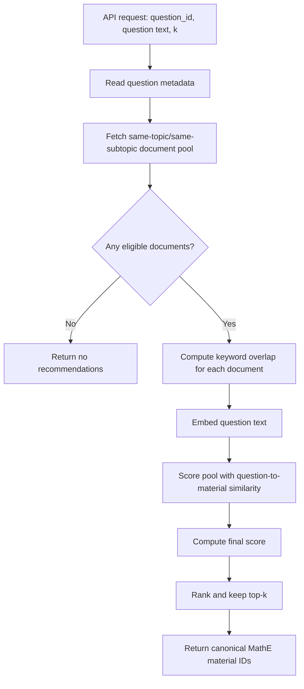

# MathE Material Recommender

This document describes the recommendation approach currently deployed for MathE materials.

The service receives:

- the MathE question ID
- the question text, usually in LaTeX format
- the number of recommendations to return

It returns MathE material IDs, ranked from most to least relevant.

## Method in Brief

A student or teacher working on a question should be pointed to materials that
teach what that question is about. The recommender does this in three steps:

1. **Stay inside the curriculum.** Only materials that MathE assigned to the
   same topic and subtopic as the question are considered.
2. **Combine two independent signals.** Within that pool, each material is
   scored by how many of the question's keywords it shares, and by how close
   its actual content is to the question text.
3. **Return only materials with a reason to be there.** A material with neither
   signal is left out, so a list is never padded with arbitrary entries.

```text
final_score = 0.6 * keyword_jaccard + 0.4 * question_to_material_similarity
```

## Why This Design

- **Curricular correctness comes first.** Topic and subtopic are assigned by
  the MathE team. Using them as a hard filter guarantees that a recommendation
  is never off-topic, which a similarity score alone cannot promise.
- **Two signals cover each other's gaps.** Keywords are precise but sparse:
  two materials with the same keywords cannot be told apart, and some materials
  have none. Content similarity reads the material itself (OCR text or
  transcript), so it separates materials with identical keywords and still
  works when keywords are missing. Conversely, a material whose text could not
  be extracted is still ranked on its keywords.
- **Every score can be explained.** A result's position follows from two
  numbers with a plain meaning, and both can be reported per material.
- **No arbitrary results.** A material without any signal is not returned.
  A shorter list is preferred to one that contains items in a meaningless
  order.
- **Low request cost.** One short question is embedded per request. Materials
  were embedded ahead of time, and only the materials in the question's pool
  are scored.

## Current Scope

This page describes the document recommendation endpoint. Supported document
formats are PDF, DOCX, and PPTX. Video lessons and reviews are served separately
by `/dataset-recsys/mathe/recommend/videos` and are never blended into document
recommendations. The video endpoint applies the same method to video
transcripts; see
[MathE Document and Video Separation](mathe_content_separation.md).

How materials are discovered, converted to text and embedded is described in
[MathE Workflows](mathe_workflows.md). Document text is indexed under
`mathe_documents`; video transcripts are indexed under `mathe_videos`.

The production system enforces a hard rule that a recommended material must
have exactly the same topic and subtopic as the question.

## Signals Used

For each question, the recommender uses:

- topic
- subtopic
- keywords
- the question itself

For each material, the recommender uses:

- topic
- subtopic
- keywords
- OCR-extracted text

There are two scores a material gets:

```text
keyword_jaccard
question_to_material_similarity
```

`keyword_jaccard` measures keyword overlap between the question and material.

`question_to_material_similarity` measures similarity between the embedded
question text and the stored material text embedding. 

## Production Flow



## Request-Time Logic, Step By Step

### Step 1 - API Receives The Request

The production API endpoint is in:

```text
dataset_recsys/api/routes/mathe.py
```

The route calls:

```text
recommend_from_curricular_pool(...)
```

from:

```text
dataset_recsys/mathe_recommenders/curricular_pool_ranker.py
```

This is the production recommender path.

### Step 2 - Load Question Metadata

The recommender first loads the MathE metadata for the question:

```text
topic
subtopic
keywords
```

This is done through:

```text
MatheMirrorClient.get_question_metadata(...)
```

in:

```text
dataset_recsys/storage/mathe_mirror_client.py
```

If the question does not exist in the mirror database, the recommender returns
no recommendations.

### Step 3 - Build The Eligible Material Pool

The production recommender then fetches all supported document teaching
materials assigned to the same topic and subtopic as the question.

This is done through:

```text
MatheMirrorClient.get_document_materials_for_question_topic_subtopic(...)
```

in:

```text
dataset_recsys/storage/mathe_mirror_client.py
```

### Step 4 - Compute Keyword Overlap

For every material in the eligible pool, the recommender computes:

```text
keyword_jaccard =
  |question_keywords intersection material_keywords|
  /
  |question_keywords union material_keywords|
```

If both keyword sets are empty, the score is `0.0`.

The helper is:

```text
compute_keyword_jaccard(...)
```

in:

```text
dataset_recsys/mathe_recommenders/seed_scoring.py
```

Inside this production ranker, `metadata_score` is set equal to
`keyword_jaccard`, because topic and subtopic have already been used to define
the pool.

### Step 5 - Embed The Question Text

The question text sent by MathE is embedded at request time.

This is done by:

```text
encode_question(...)
```

in:

```text
dataset_recsys/mathe_recommenders/question_embedding.py
```

The same embedding model is used for MathE material OCR embeddings.

### Step 6 - Score Eligible Materials Against The Question

The recommender scores only the materials already present in the eligible pool.

This is done with:

```text
score_question_similarity_for_material_ids(...)
```

in:

```text
dataset_recsys/mathe_recommenders/question_embedding.py
```

Internally, this calls:

```text
QdrantStorageClient.find_similar_by_ids(...)
```

from:

```text
dataset_recsys/storage/qdrant_client.py
```

This means the vector query asks:

```text
For these specific eligible material IDs, how similar is each one to the question?
```

It does not perform an open nearest-neighbor search over all materials.

If an eligible material has no stored embedding, it keeps:

```text
question_to_material_similarity = 0.0
```

### Step 7 - Compute Final Score

The final score is computed in:

```text
_rank_candidates(...)
```

inside:

```text
dataset_recsys/mathe_recommenders/curricular_pool_ranker.py
```

The score is:

```text
final_score =
    lambda * keyword_jaccard
  + (1 - lambda) * question_to_material_similarity
```

The default is:

```text
lambda = 0.6
```

So by default:

```text
final_score =
    0.6 * keyword_jaccard
  + 0.4 * question_to_material_similarity
```

The reason for this weighting is that, after the hard topic/subtopic filter,
keyword overlap is the remaining explicit curriculum signal. The question
embedding then refines the order inside the same curricular pool.

`keyword_jaccard` lies between 0 and 1. A cosine similarity can be negative,
which has no meaning as a relevance contribution, so a negative similarity
counts as `0.0` in the sum. The reported `question_to_material_similarity`
keeps the measured value.

A material whose `final_score` is `0.0` has no ranking signal, so it is left
out of the result: any position given to it would be arbitrary. The ranker can
therefore return fewer than the requested number of materials, or none. There
are two such cases, both without a keyword shared with the question:

```text
zero_score_no_embedding     no stored mathe_documents embedding
zero_score_with_embedding   an embedding whose similarity is zero or negative
```

These materials can be listed. `score_curricular_pool_candidates(...)` returns
the whole pool for a question, with `final_score`, `has_embedding` and an
`exclusion_reason` that is empty for ranked materials. The ranker also writes
an INFO log line naming the left-out material IDs and their reasons whenever a
request leaves any out.

### Step 8 - Return MathE Material IDs

Candidates are keyed internally by the canonical MathE platform material ID,
which is also the ID used by the `mathe_documents` embedding collection:

```text
30
31
32
```

The API response returns that same MathE material ID:

```text
30
```

## How the Recommender Is Evaluated

Offline evaluation is described in `evaluation/mathe/README.md`. It uses one
benchmark question per topic/subtopic pool, chosen from questions that students
actually attempted, and three kinds of relevance labels that must not be
confused:

| Label | What it is | What it can show |
|---|---|---|
| Expert reference documents | Material IDs that the MathE team marked as relevant for a benchmark question | Agreement with human judgement. This is the only ground truth |
| Keyword-overlap proxy | Materials whose MathE keywords overlap with the question's | Internal consistency only. The ranker itself uses keyword overlap, so this cannot count as independent evidence of relevance |
| Click proxy | The most-clicked material of the pool, from a global click counter | Whether a popular material is surfaced. Clicks are not tied to a question |

The reported measures are precision at 5 and at `k`, hit rate at `k`, and a
weighted nDCG at `k`. Questions without expert labels are excluded from the
expert-reference averages and counted separately.

Because zero-score materials are left out, a result list can be shorter than
`k`. Precision is computed over the returned list, so results obtained before
and after that rule was introduced are not directly comparable.

The video recommender has not been evaluated yet. Its keyword weight is the
document default.

## What Changed From The Previous Hybrid Version

The previous hybrid recommender used three sources:

```text
metadata seed documents
OCR-neighbor documents
question-nearest documents
```

That approach was useful for open discovery, but it could recommend materials
outside the exact question topic/subtopic.

The older hybrid implementation is still kept for comparison and validation:

```text
dataset_recsys/mathe_recommenders/hybrid.py
```

These comparison strategies now query the `mathe_documents` namespace with
canonical MathE platform material IDs as well. They differ from production in
their candidate-generation and ranking strategies, not in their ID format or
content namespace.

## Implementation Map

| Step | File | Function | Role |
| --- | --- | --- | --- |
| API entry point | `dataset_recsys/api/routes/mathe.py` | route handler | Receives the MathE request and calls the production recommender. |
| Production recommender | `dataset_recsys/mathe_recommenders/curricular_pool_ranker.py` | `recommend_from_curricular_pool` | Returns top-k material IDs from the same topic/subtopic document pool. |
| Candidate ranking | `dataset_recsys/mathe_recommenders/curricular_pool_ranker.py` | `rank_curricular_pool_candidates` | Builds the eligible pool, scores it, and ranks candidates. |
| Final scoring | `dataset_recsys/mathe_recommenders/curricular_pool_ranker.py` | `_rank_candidates` | Computes `final_score` and sorts candidates. |
| Question metadata | `dataset_recsys/storage/mathe_mirror_client.py` | `get_question_metadata` | Reads question topic, subtopic, and keywords. |
| Eligible pool | `dataset_recsys/storage/mathe_mirror_client.py` | `get_document_materials_for_question_topic_subtopic` | Fetches supported teaching material documents in the same topic/subtopic as the question. |
| Keyword score | `dataset_recsys/mathe_recommenders/seed_scoring.py` | `compute_keyword_jaccard` | Computes question/material keyword overlap. |
| Question embedding | `dataset_recsys/mathe_recommenders/question_embedding.py` | `encode_question` | Embeds the MathE question text. |
| Question similarity | `dataset_recsys/mathe_recommenders/question_embedding.py` | `score_question_similarity_for_material_ids` | Scores eligible materials against the question embedding. |
| Vector scoring by IDs | `dataset_recsys/storage/qdrant_client.py` | `find_similar_by_ids` | Scores only the material IDs already in the eligible pool. |
| Comparison CLI | `dataset_recsys/utils/mathe_recsys_compare_cli.py` | `main` | Runs selected recommender approaches for validation and CSV/JSON export. |

## Configuration

The production curricular pool ranker is controlled by:

```text
MATHE_CURRICULAR_KEYWORD_WEIGHT
MATHE_EMBEDDING_MODEL
```

Current defaults:

```text
MATHE_CURRICULAR_KEYWORD_WEIGHT=0.6
MATHE_EMBEDDING_MODEL=BAAI/bge-m3
```

The question similarity weight is always:

```text
1 - MATHE_CURRICULAR_KEYWORD_WEIGHT
```

The older recommenders are still available for comparison:

```text
dataset_recsys/mathe_recommenders/metadata_ocr.py
dataset_recsys/mathe_recommenders/question_embedding.py
dataset_recsys/mathe_recommenders/hybrid.py
```

They can be compared through:

```text
dataset_recsys/utils/mathe_recsys_compare_cli.py
```
