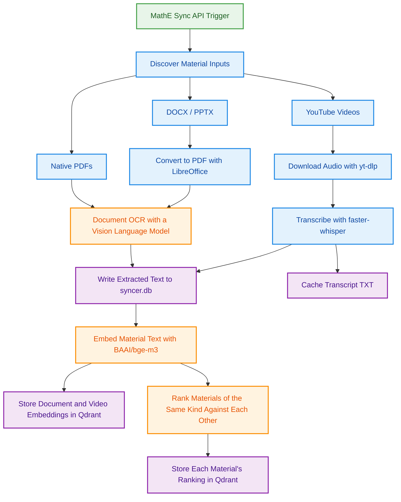

# MathE Workflows

This page describes how MathE teaching materials are turned into a searchable
index: discovery, text extraction, embedding, and publication to Qdrant. How a
question is then matched to materials is described in
[MathE Material Recommender](mathe_material_recommender.md).

## Sync, Extraction, and Refresh



This workflow is implemented by:

```text
dataset_recsys/utils/mathe_syncer.py
dataset_recsys/workflows/mathe_sync_pipeline.py
```

A sync first checks that the material folders exist and stops with an error if
one is missing, so an unmounted folder can never be mistaken for removed
materials.

### Text Extraction Methods

| Material | Method |
|---|---|
| PDF | Each page is rendered as an image and transcribed by a vision language model, with equations written in LaTeX and the document's own language kept. The PDF's embedded text layer is not used, because it garbles mathematical notation |
| DOCX, PPTX | Converted to PDF with LibreOffice, then handled like a PDF |
| YouTube video | The audio track is downloaded with `yt-dlp` and transcribed with `faster-whisper` (model `base`) |

The OCR backend is selected with `MATHE_OCR_BACKEND`:

| Value | Model | How the document is sent |
|---|---|---|
| `scayle` (default) | `qwen3.6` on the SCAYLE model service | One request per rendered page |
| `bedrock` | Claude Sonnet 4.5 on Amazon Bedrock | The whole PDF in one request |

Both use a sampling temperature of 0. The model that produced a document's
text is recorded with it (see [Output State](#output-state)), so a corpus
processed partly with one backend and partly with the other can be told apart.

### Embedding and Ranking

Each completed text is embedded once with `BAAI/bge-m3`. Texts longer than the
model's 8192-token window are split into paragraphs, and the paragraph
embeddings are averaged. Within each content kind, every material is ranked
against all others by cosine similarity, and the complete ranking is stored
with the material.

The `/dataset-recsys/mathe/recommend/documents` endpoint builds its
request-time candidate pool from document teaching materials in the same
topic/subtopic as the question and scores their canonical platform IDs against
the `mathe_documents` embedding namespace.

The separate `/dataset-recsys/mathe/recommend/videos` endpoint builds the same
hard topic/subtopic pool using only video types `1` and `2`, then scores those
platform material IDs against `mathe_videos`.

### Precomputed Question Rankings

To avoid embedding and scoring a known question on every request, build a
snapshot in the environment that owns the MathE mirror, Qdrant index, and sync
status file:

```bash
poetry run python -m dataset_recsys.utils.mathe_precompute
```

The job uses the catalog's question text and the same document and video
rankers as the API. It stores each eligible candidate's cosine similarity,
keyword overlap, final score, and exclusion reason alongside the ordered
material IDs. The Qdrant alias `mathe_question_rankings` switches only after
the entire snapshot is written.

By default the API uses the snapshot and refreshes it after successful full
and incremental MathE syncs. Set `MATHE_PRECOMPUTED_RANKINGS=false` to disable
both behaviors. The API still checks authorization. It uses live scoring for unknown or edited questions,
an incompatible scoring configuration, or a missing or outdated snapshot.
An empty stored ranking is a valid result.

The CLI must use the same `MATHE_PATH`, Qdrant instance, model, and weights as
the API. Run one publisher at a time. The mirror is maintained outside this
repository: arrange for its update process to run the CLI after metadata edits,
or run it manually. Until then, changes to topics, keywords, and material
eligibility may leave rankings stale even when question text is unchanged.

Snapshots do not expire by age. The API skips a snapshot associated with an
earlier sync or incompatible question text or scoring configuration. The sync
status endpoint reports `ranking_refresh` as `disabled`, `running`, `completed`,
or `failed`, with timestamps and a question count after a successful refresh.
If refresh fails, material sync can still complete and the API uses live scoring.
CLI refresh results are reported in its logs.

## Sync Endpoints

Two endpoints start the workflow as a background task and return immediately.
Both accept the `user`, `dg_user` and `dg_system` roles.

```text
POST /dataset-recsys/mathe/sync
POST /dataset-recsys/mathe/sync/rebuild
```

`/sync` runs the incremental pipeline. After discovery and OCR it compares the
completed catalog with the stored `mathe_documents` and `mathe_videos`
collections: new materials are embedded and linked to the other materials of
their content kind, and materials no longer in the catalog are removed
together with every reference to them. A material that is already stored is
not embedded again, even if its text changed.

`/sync/rebuild` runs the full pipeline. It embeds every completed material
again and replaces both collections, so it also picks up changed text.

Both pipelines store the complete neighbor ranking for each material, so an
index built by incremental syncs matches one built by a full rebuild of the
same catalog. `GET /dataset-recsys/mathe/status` reports the progress of
either run.

The recommendation endpoints answer `200` with an empty `recommendations` list
when there is nothing to recommend; they do not return `404`.

## Material Inputs

The syncer can prepare text from several material sources:

- native PDFs under `<MATHE_PATH>/pdfs`
- DOCX files under `<MATHE_PATH>/docxs`
- PPTX files under `<MATHE_PATH>/pptxs`
- YouTube videos discovered from the MathE platform registry

DOCX and PPTX materials are converted to temporary PDFs with LibreOffice before
OCR is applied.

For YouTube materials, the syncer accepts either full YouTube URLs or raw
11-character YouTube IDs. It uses `yt-dlp` to download audio, `faster-whisper`
to transcribe speech, and `<MATHE_PATH>/transcripts/<video_id>.txt` as a local
transcript cache.

The MathE platform material types are:

- `1`: Video Lesson
- `2`: Video Review
- `3`: Teaching Material

The syncer discovers video materials and preserves their MathE identity with:

```text
SELECT id, link, type
FROM platform_materials
WHERE type IN (1, 2)
ORDER BY id;
```

This selects both video categories and excludes `type = 3` teaching materials.
After fetching links, the syncer still validates each value with YouTube
detection logic. Only values that look like a YouTube URL or an 11-character
YouTube ID are queued for transcription.

## Output State

The syncer writes its local processing catalog to:

```text
<MATHE_PATH>/syncer.db
```

This sqlite file is the syncer's checkpoint. It lets the next sync run know which
materials have already been discovered, which ones still need processing, and
which ones failed.

Each entry stores fields such as:

```text
id
type
source_value
internal_pdf_path
claude_ocr_text
ocr_model
status
platform_material_id
content_subtype
```

`claude_ocr_text` holds the extracted text whichever model produced it; the
column keeps its original name to avoid a schema change. `ocr_model` names the
model that produced a document's text. It is empty for videos, for failed OCR,
and for documents processed before the column was introduced, whose model was
not recorded.

The exact fields depend on the material type:

- PDFs, DOCX, and PPTX entries use `type: document` and usually include
  `internal_pdf_path`, pointing to either the native PDF or the temporary PDF
  produced by LibreOffice. Their subtype is `pdf`, `docx`, or `pptx`, and their
  numeric filename stem is retained as `platform_material_id`.
- YouTube entries use `type: video`, keep the original platform link in
  `source_value`, and store the transcript text in `claude_ocr_text`. Their
  `content_subtype` distinguishes `video_lesson` from `video_review`;
  `platform_material_id` stores `platform_materials.id`; and the existing `id`
  stores the YouTube ID. PostgreSQL discovery is exposed by
  `MatheMirrorClient.get_video_materials()`; the syncer does not contain or
  execute platform SQL directly.

`type` is the recommendation boundary: it is either `document` or `video`.
Audio is only an intermediate artifact in the video-to-audio-to-transcript
processing path and is not stored as the material type. The transitional
migration converts deployed `type: audio` rows to `type: video` in place.

`id` remains the processing key: a document filename or a YouTube ID.
API-facing identity and the document and video collections use
`platform_material_id`.

Existing SQLite catalogs are migrated in place. Missing columns are added with
`ALTER TABLE`, document identities are backfilled from numeric filenames, and
legacy audio entries are classified as videos. A legacy video receives its
MathE `platform_material_id` and lesson/review subtype on the next successful
PostgreSQL discovery pass. Until then, its `content_subtype` remains null rather
than introducing a video subtype that is not defined by MathE. This temporary
compatibility logic is isolated in `mathe_sync_migrations.py` so it can be
deleted after all deployed catalogs have been upgraded.

`status` controls what happens in later runs:

- `pending` means the material has been discovered but not successfully
  processed yet.
- `completed` means usable text exists in `claude_ocr_text`.
- `failed` means OCR or transcription failed and the entry is skipped by the
  current batch processing loop.

Only completed entries with non-empty `claude_ocr_text` are used by the refresh
pipeline. Each text is embedded once. The pipeline publishes strict
`mathe_documents` and `mathe_videos` collections. They use
`platform_material_id` keys and compute neighbors independently, so their
recommendation lists cannot cross the document/video boundary. A completed
video without a resolved platform ID is skipped from `mathe_videos` until
PostgreSQL discovery enriches it. The mixed legacy `mathe` collection is
retired and no longer published.

For videos, the syncer also writes transcript backups to:

```text
<MATHE_PATH>/transcripts/<video_id>.txt
```

These backups let the syncer restore completed transcript text without
downloading and transcribing the same video again.

## Configuration

The syncer depends on the mounted material folder and on credentials for the
external systems it reads from or writes to.

```text
MATHE_PATH
```

`MATHE_PATH` is the root folder for MathE material processing. Under this path,
the syncer expects or creates folders/files such as:

```text
pdfs/
docxs/
pptxs/
transcripts/
syncer.db
sync_status.json
cookies.txt
```

The PostgreSQL settings let the syncer read MathE platform material links:

```text
DATAGEMS_POSTGRES_HOST
DATAGEMS_POSTGRES_PORT
DB_DS_NAME
DB_DS_USER
DB_DS_PASSWORD
DATAGEMS_POSTGRES_SCHEMA
```

The document OCR backend and its credentials:

```text
MATHE_OCR_BACKEND      scayle (default) or bedrock

SCAYLE_BASE_URL        used when MATHE_OCR_BACKEND=scayle
SCAYLE_USERNAME
SCAYLE_PASSWORD
SCAYLE_VERIFY_SSL

AWS_ACCESS_KEY         used when MATHE_OCR_BACKEND=bedrock
AWS_SECRET_KEY
```

The embeddings and rankings are written to Qdrant:

```text
QDRANT_HOST
QDRANT_PORT
QDRANT_API_KEY
MATHE_EMBEDDING_MODEL  default BAAI/bge-m3
```

Video transcription depends on:

```text
ffmpeg
yt-dlp
faster-whisper
```

`yt-dlp` downloads the YouTube audio stream, `ffmpeg` extracts/converts the
audio, and `faster-whisper` produces the transcript. The container installs
`ffmpeg`; the Python dependencies are declared in `pyproject.toml`.

If `<MATHE_PATH>/cookies.txt` exists, `yt-dlp` uses it when downloading YouTube
audio. This is useful for videos that need consent/session cookies or are not
downloadable anonymously.
