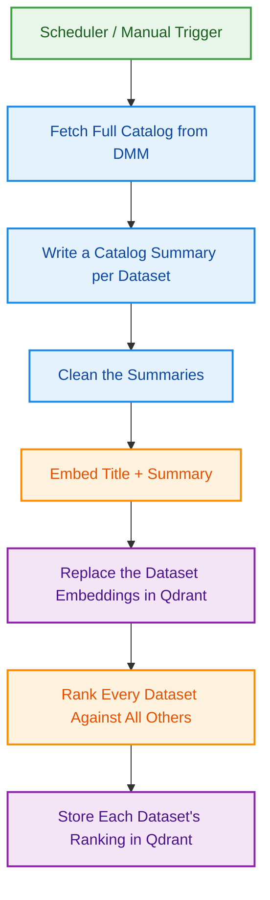
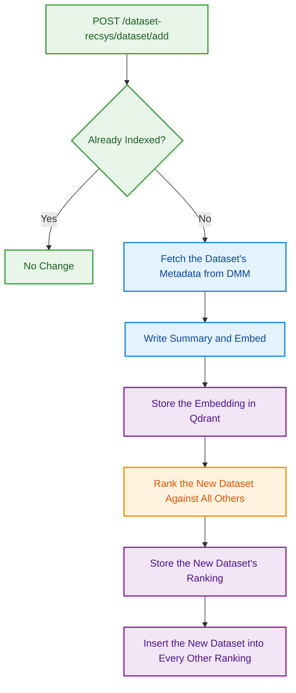
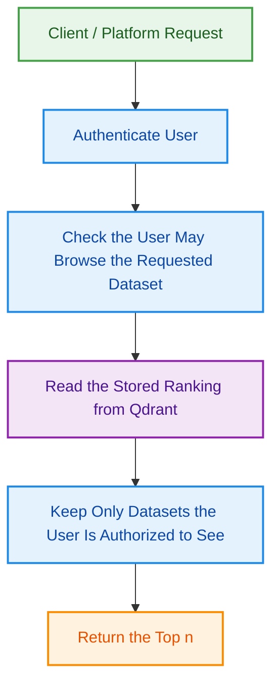

# Dataset Recommender Workflows

This page describes how the DataGEMS dataset recommender builds its index and
answers requests. The MathE workflows are described in
[MathE Workflows](mathe_workflows.md).

The dataset recommender has four workflows: a full rebuild, adding one dataset,
removing one dataset, and serving recommendations.

## 1. Full Rebuild

The full rebuild recomputes the whole index. It is used for the initial
deployment, after a larger metadata update, or after a model change.

| Step | What happens |
|---|---|
| Fetch | The complete catalog is read from the DMM instance set by `DMM_BASE_URL`, page by page. If that setting is missing, the rebuild stops before it requests anything |
| Summarise | A language model (Claude on Amazon Bedrock, prompt version `catalog_summary_v1`) writes an 80 to 150 word catalog summary from each dataset's title, headline, description, keywords and field of science |
| Embed | Title and summary are embedded with `allenai/specter2_base`, using mean pooling over at most 512 tokens |
| Store | The new embeddings are written, then datasets that are no longer in the catalog are deleted, so the index always matches the catalog |
| Rank | Cosine similarity between all pairs of datasets; each dataset stores its complete ranking with scores |

Each stored embedding records the embedding model, the summary model, the
prompt version and a run ID, so an index can be traced back to how it was
built.

The summaries are generated with a non-zero sampling temperature. Two rebuilds
of the same catalog can therefore produce slightly different summaries and
rankings. Reproducing a specific index means keeping its stored embeddings, not
regenerating them.

## 2. Adding One Dataset

A new dataset becomes recommendable without a full rebuild. It receives its
complete ranking against the existing datasets, and it is inserted at the right
position in each of their rankings. The result is the same as a full rebuild of
the enlarged catalog would store for that dataset.

## 3. Removing One Dataset

`POST /dataset-recsys/dataset/remove` deletes the dataset's embedding and its
ranking, and removes it from every other dataset's ranking, so it can no longer
be recommended.

`POST /dataset-recsys/dataset/exist` reports, for a list of dataset IDs, which
ones are indexed.

The three management endpoints require the `dg_admin`, `dg_dataset-curator` or
`dg_system` role.

## 4. Recommendation Serving with Access Control

This is the request-time path of `POST /dataset-recsys/recommend`. No model is
called: the ranking was computed ahead of time, and the API authenticates the
requester, filters, and cuts the list to the requested length. Users with the
`dg_admin`, `dg_dataset-curator` or `dg_system` realm role can access all
datasets. Other users need the `dg_user` realm role and a `dg_ds-browse` grant for the source
dataset and receive only recommendations for datasets they can also browse.

| Situation | Response |
|---|---|
| The dataset is not indexed | `404` |
| The user may not browse the requested dataset | `403` |
| The dataset is indexed | The top `n` datasets the user is authorized to see, best first. The list is empty when the dataset has no stored ranking or the user may see none of the ranked datasets |

The filter is applied to the complete stored ranking before the list is cut to
`n`. A user with access to few datasets therefore still receives the best
matches among the datasets they may see.

`POST /dataset-recsys/recommend/ap` offers the same recommendations for
requests expressed as a DataGEMS Analytical Pattern, and returns the pattern
with the recommended datasets attached.

Every request is written to the accounting log and to the six-month request
log (user, requested dataset, number of results, status, duration).
